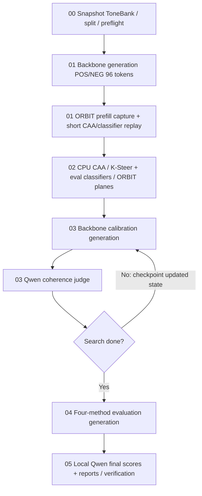

# ToneBank trên Kaggle 2×T4 — workflow paper, phiên bản 2

Bản này thực hiện yêu cầu **bỏ judge lọc POS/NEG, gộp sinh response và trích
activation**. Source numerical gốc vẫn giữ nguyên. Workflow 7 notebook trước đây
được lưu nguyên gói tại [legacy/orbit_kaggle_repo_filtered_bundle.zip](legacy/orbit_kaggle_repo_filtered_bundle.zip).
Không trộn checkpoint/code/config của hai workflow.

Legacy ZIP chỉ giữ riêng trong repo, **không đặt trong Code Dataset mới**:
Kaggle có thể giải nén cả ZIP lồng nhau, gây phát hiện hai bundle và lỗi manifest.
Nếu gặp đường dẫn `.../legacy/orbit_kaggle_repo_filtered_bundle`, cập nhật Dataset
bằng ZIP và SHA mới trong dist, bỏ bản legacy đã giải nén khỏi Dataset.

## Thay đổi quan trọng

* POS/NEG dùng chính backbone, **system instruction + user question**, tối đa
  **96 new tokens**, theo Appendix C.1 của `2606.22357v1.pdf`.
* **Không có bước judge/filter build.** Mọi cặp đã sinh được dùng để xây artifact.
  Báo cáo ghi `filter_policy=none`; tỷ lệ lọc không áp dụng, không tạo điểm judge giả.
* ORBIT capture các LayerNorm output tại **last prompt token trong generation
  prefill**, chỉ giữ một vector/site. Các bước decode sau không ghi đè vector đó.
  Không forward lại prompt riêng để lấy ORBIT.
* CAA/K-Steer/eval giữ feature của repo tại last non-pad token của raw
  `instruction + question + "\n" + response`. Cần **một forward replay ngắn**
  cho POS/NEG sau khi sinh, trong cùng worker. Không tuyên bố mọi method chỉ có
  một forward: hidden state decode không tương đương feature tokenize lại của repo.
* Chỉ load một backbone trong stage 01. Stage 02 dựng artifact/train classifier
  từ CPU shards, không load backbone hay judge.
* Calibration và chấm kết quả cuối **vẫn dùng Qwen3.5-9B local**. Không OpenAI SDK,
  API key, endpoint hay dịch vụ inference trả phí.

Đây là bản đối chiếu quy trình paper, **không phải tái lập tuyệt đối**: evaluator
khác GPT-4o-mini, FP16 trên T4, classifier CPU, CAA composition/feature sites và
ORBIT global-plane implementation bám repo. Split luôn khai báo rõ. Xem
[SOURCE_MAP.md](SOURCE_MAP.md), [TEST_REPORT.md](TEST_REPORT.md).

## Sáu notebook mới



| Notebook | Input | Output / model tải |
|---|---|---|
| 00_prepare_data | Code Dataset mới | Dataset snapshot/IDs/split, access, hardware, estimate; smoke load từng judge/backbone |
| 01_generate_and_extract | Output 00 hoặc checkpoint mới nhất của chính 01 | POS/NEG, activation CPU shards; chỉ backbone |
| 02_build_artifacts | Output 01 completed | CAA, K-Steer/eval classifier checkpoints, ORBIT candidates/global planes; CPU |
| 03_calibrate | Output 02 | Search state/history, generations và judge cache; backbone/judge luân phiên subprocess |
| 04_generate_evaluation | Output 03 | Unsteered, CAA, K-Steer, ORBIT responses, hook audit, telemetry; backbone |
| 05_judge_and_report | Output 04 | Qwen target/detailed/ToneJudge nếu bật, CSV, CI, errors, REPORT.md; judge rồi CPU |

Các tên notebook cũ 01_generate_build_responses, 02_filter_build_with_qwen,
03_extract_and_build_artifacts và 06_judge_and_report không thuộc workflow mới.
Bản cũ vẫn chạy được bằng bundle legacy riêng, không cần chuyển run đang dở.

## Bắt đầu trên Kaggle

1. Upload **dist/orbit_kaggle_bundle.zip và .sha256** làm Code Dataset mới.
   Kaggle có thể giải nén ZIP; bootstrap nhận cả ZIP và thư mục, kiểm từng checksum.
   Không dùng Code Dataset cũ: notebook sẽ dừng nếu thiếu `fused_build.py`.
2. Import notebook 00 mới. Chọn **GPU T4 ×2**, Internet On. Thêm và cấp quyền
   dùng Kaggle Secret `HF_TOKEN`; token phải có quyền đọc cả hai Llama gated.
3. Chạy smoke mới qua 00 → 05, kiểm raw judge/response và hook verification.
   Chưa có kết quả chạy T4 được xác nhận sẵn. Không local GPU đã chạy.
4. Chạy full hoặc pilot với RUN_LABEL mới. Mỗi run chỉ một backbone:
   `meta-llama/Llama-3.2-3B-Instruct`, `Qwen/Qwen2.5-7B-Instruct`,
   `meta-llama/Llama-3.1-8B-Instruct`. Qwen3.5-9B chỉ là evaluator.

Ví dụ run đầy đủ bám shared pool của launcher, với **build paper mới**:

```python
MODE = "full"
TARGET_MODEL_ID = "meta-llama/Llama-3.2-3B-Instruct"
SPLIT_MODE = "shared_pool"  # question_holdout nếu muốn câu hỏi build/cal/test tách nhau
PRECISION_PROFILE = "fp16"
POS_NEG_SOURCE = "backbone"
RUN_LABEL = "tonebank-paper-full-v2"
PREVIOUS_RUN_INPUT = None  # chỉ notebook 00 khi bắt đầu; 01–05 đặt output trước
```

Giữ các tham số giống nhau trong cả sáu notebook. `launcher_reference.json` còn
là alias full/shared_pool để tương thích tên lựa chọn, **nhưng cấu hình build mới
là 96 tokens/system/unfiltered**, không còn là bản launcher 2048/user/filtered.
Muốn giữ nguyên protocol launcher cũ, dùng bundle legacy.

| Mode | Pool câu hỏi | Pairs tối đa/tone | POS/NEG token cap | Calibration tối đa | Vòng | Eval questions | Eval token cap | Combos |
|---|---:|---:|---:|---:|---:|---:|---:|---:|
| smoke | 40 | 16 | 96 | 2 | 2 | 2 | 64 | 5, K=1 |
| pilot | 60 | 30 | 96 | 6 | 3 | 6 | 192 | 25 |
| full | 200 | 150 | 96 | 100 | 8 | 16 | 384 | 25 |

`question_holdout` full: train=50, calibration=75, eval=16; shared_pool full:
train pool=200, calibration=100, eval=16. Cùng dataset revision, stable IDs,
dedup policy và split seed. Shared_pool có chồng câu hỏi, không báo là holdout.
Không sinh lại câu hỏi ToneBank hoặc TraitFactory. POS/NEG vẫn phải sinh.

## Tiếp tục qua các phiên

Output hiện tại ở `/kaggle/working/orbit_runs/RUN_LABEL/MODEL_SLUG`. Input đã lưu
ở `/kaggle/input/...`. Cell cuối mỗi notebook tạo index và các archive parts
<=1 GiB uncompressed/phần; file cá biệt lớn hơn 1 GiB không bị cắt giữa tensor.
Bản unpacked được giữ tại `/tmp/orbit-unpacked-...` trong phiên.

* **Snapshot chỉ là file local**, không tự upload hoặc Save Version. Kiểm các dòng
  SESSION FILE và checksum. Với checkpoint <=64 MiB, còn có ZIP ngay trong
  `/kaggle/working` để tải; lớn hơn giữ archive parts để tránh nhân đôi đĩa.
* Save Version **có output files**. Nếu Quick Save có Advanced Settings, bật lưu
  output files. Chờ version hoàn tất, mở đúng version → Output, xác nhận có
  checkpoint_index.json và checkpoint-part-*.tar.gz hoặc ZIP. `Output: 0 files`
  nghĩa là version chưa có checkpoint để truyền sang notebook sau; log cũ không đủ.
* Có thể dùng Save & Run All, nhưng đây là **phiên sạch chạy lại từ đầu**. File
  tương tác chưa lưu thành Input không tự chuyển sang phiên đó.
* Notebook tiếp theo: Add Input → Notebook Outputs → chọn version đã có file.
  Add cả Code Dataset mới. Đặt PREVIOUS_RUN_INPUT tới **thư mục chứa trực tiếp
  checkpoint_index.json**. Code kiểm checksum rồi tự restore.
* Nếu tải ZIP thủ công, upload thành Dataset riêng rồi Add Input. Sau khi Kaggle
  giải nén, PREVIOUS_RUN_INPUT vẫn trỏ tới thư mục có index; không cần tự giải nén tar.
* Stage chưa completed: resume **chính notebook đó** bằng checkpoint cumulative
  mới nhất; không chuyển stage phụ thuộc. Không thêm nhiều snapshot cùng run.

`TIME_BUDGET_SECONDS` bản mới là **tổng ngân sách notebook**, gồm thời gian setup.
Mỗi stage nhận thời gian còn lại. Dừng tại checkpoint kiểm tra tiếp theo, không
ngắt cứng tác vụ đang chạy; cần chừa thời gian đóng gói và Save Version theo giới
hạn phiên thực tế của tài khoản. File trên đĩa phiên chưa bền vững sau khi mất phiên.

Stage 01 checkpoint từng phía POS/NEG cùng norm activation. Nếu bị ngắt giữa
cặp, phía đã ghi không sinh lại. Sau khi cặp có response + activation đầy đủ,
side cache tạm được bỏ để không lưu hai bản norm. Mỗi generation dùng seed theo
sample/polarity, không phụ thuộc shard order hay resume. Classifier lưu Adam,
minibatch cursor và shuffle seed. Cache khác config/model/precision bị từ chối.

## Hardware, dependency và precision

Bootstrap dùng uv 0.8.22 wheel có SHA-256 cố định, managed Python 3.12.11 và
pip 25.2 trong `/tmp`; không cần ensurepip của kernel Python 3.13, apt hay sudo.
Pin runtime.lock.txt, torch 2.6.0/torchvision 0.21.0 CUDA12.4; bitsandbytes 0.48.2
chỉ GPU profile cần. Không đổi dependency kernel Kaggle. Không tải weights vào Output.

Backbone mặc định FP16, device_map balanced, budget riêng từng GPU = VRAM free
trừ reserve 2 GiB. Không cộng VRAM thành một GPU, không mặc định BF16/FlashAttention.
Qwen3.5 dùng AutoProcessor + AutoModelForImageTextToText đúng kiến trúc hybrid,
thinking=False. Cần smoke generate thật trên Kaggle; chưa xác nhận T4 local.

`judge_nf4`: backbone FP16/judge NF4. `low_memory_nf4`: cả hai NF4. Chạy smoke riêng
và RUN_LABEL riêng trước khi dùng quantization; không tái sử dụng activation qua
precision khác. Code chỉ tự giảm **batch**, không giảm token/sample/combos/precision.
Replay feature có batch 2→1 khi CUDA OOM và ghi event. Generation vẫn batch=1.

## Các tối ưu và giới hạn

Đã thực hiện:

1. Bỏ toàn bộ judge POS/NEG: full không còn tối đa 1.500 yêu cầu chấm build và retry.
2. Cap build 96 thay 2.048 token theo paper; cap token thấp hơn khoảng 21 lần,
   **không phải cam kết runtime nhanh hơn 21 lần**.
3. ORBIT lấy trực tiếp prefill; không load backbone lại để extraction riêng.
4. Stage artifact CPU; baseline chỉ sinh một lần/question/seed; judge cache theo
   content/rubric/revision/decoding; calibration gom các search độc lập theo vòng.
5. Resume từng side/sample; không sinh lại output đã commit. Đổi rubric báo cáo
   không yêu cầu extract activation lại.

Tùy chọn giảm thời gian thêm, **phải khai báo config và báo khác biệt**:

* `report.tone_comparison=false`: bỏ ToneJudge so sánh phụ; vẫn giữ target/detailed.
* Chỉ `report.judge_types=["target"]`: bớt một rubric nhưng không còn báo detailed.
* Judge NF4 có thể giúp bộ nhớ, **không bảo đảm nhanh hơn** trên T4/hybrid Qwen.
* Giảm vòng calibration/câu hỏi/combo/token eval làm đổi thí nghiệm; không áp dụng
  âm thầm vào full. Batch generation lớn hơn hoặc giữ judge/backbone đồng thời
  cần kiểm parity seed/activation và VRAM; chưa triển khai thành mặc định.

Ước lượng dung lượng activation trước full: `pairs × 2 × (2×layers+2) × hidden ×4`
bytes, chỉ một token/site; shard CPU float32 từ precision tính toán khai báo.
Stage estimate còn tính text và raw judge calibration/final. Không có judge build.
Pilot đo throughput/VRAM/disk thực mới là cơ sở dự trù thời gian; chưa có benchmark T4.

## Xem kết quả

Notebook 05 hiển thị summary_model_method_K.csv; report còn có detail_combinations,
per_sample, errors, score_distributions, telemetry và build_protocol.json.
Tone 0–10, coherence 0–100. Success: mọi tone target tăng so baseline cùng câu hỏi
và coherence >=50. CI bootstrap theo question ID; không nhân baseline thành mẫu
độc lập. Kết quả luôn ghi evaluator revision/precision và build filter none.
Chưa có biểu đồ tự động; không điền số liệu giả.

Đổi rubric/decoding judge hoặc chỉ chạy báo cáo nhanh không cần sinh lại response
hay trích activation. Restore checkpoint evaluation hoàn thành, giữ nguyên
backbone/split/generation/build protocol, tạo **file config scoring riêng** rồi
gọi CLI `score`. Ví dụ trong notebook đã setup:

```python
rescoring = json.loads(CONFIG_PATH.read_text())
rescoring["report"]["tone_comparison"] = False  # tùy chọn, ghi rõ báo cáo khác
rescoring_path = RUN_ROOT / "rescoring_config.json"
rescoring_path.write_text(json.dumps(rescoring, indent=2))
subprocess.run([str(PYTHON), "-m", "orbit_kaggle.cli", "score",
    "--config", str(rescoring_path), "--root", str(RUN_ROOT),
    "--time-budget", "24000"], check=True)
```

CLI tạo scoring/report fingerprint riêng, giữ evaluation/activation. Không sửa
resolved_config.json của run gốc hoặc chạy lại calibration với judge config mới
rồi coi đó là calibration cũ. Nếu CLI trả 75, lưu checkpoint và tiếp tục cùng
rescoring config. Sau scoring hoàn thành, snapshot RUN_ROOT để Save Version.

## Build lại và kiểm tra CPU

```bash
python3 kaggle/make_notebooks.py
python3 kaggle/build_bundle.py
PYTHONPATH=kaggle /path/to/cpu-env/bin/python -m unittest discover -s kaggle/tests -v
```

Các tests tiny random Llama/Qwen chỉ kiểm hook/tensor/protocol/resume, không thay
ToneBank hoặc tạo kết quả thí nghiệm. Xem TEST_REPORT.md để biết checks nào đã
chạy và checks GPU nào còn phải thực hiện trên Kaggle.
